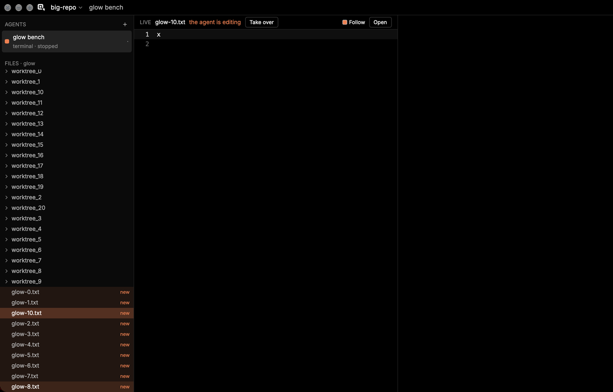
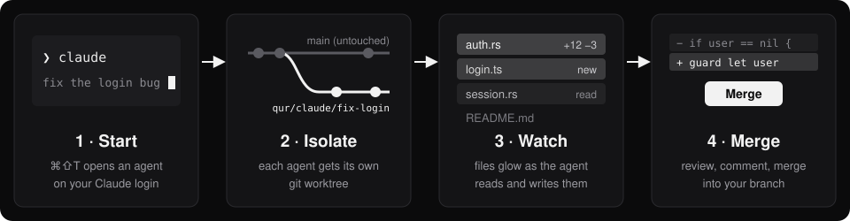
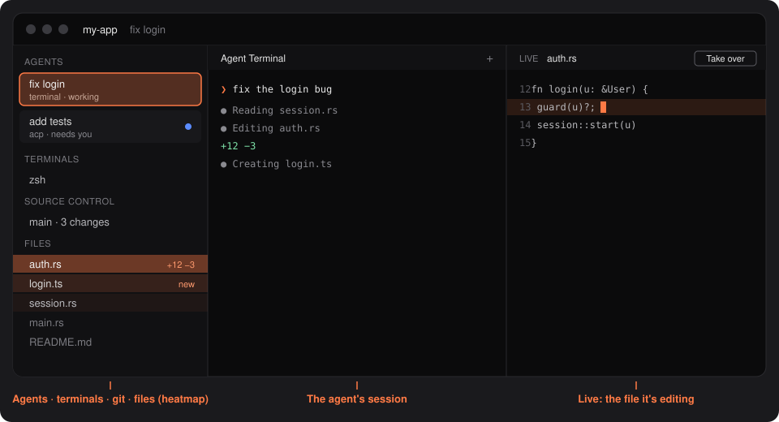
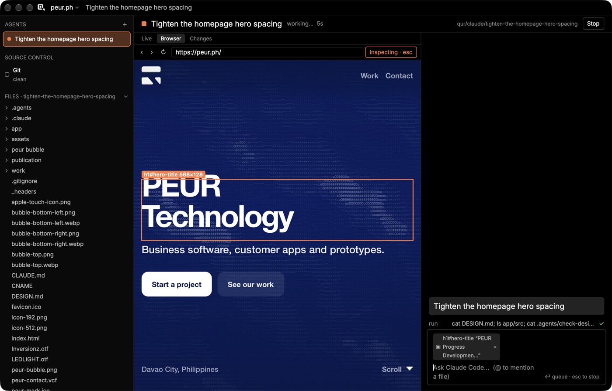
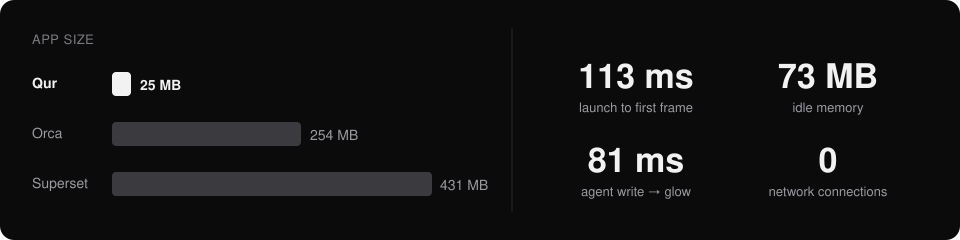

# Qur

**See what your agents see.** A native macOS editor for running AI coding agents: each one gets its own worktree, and the file tree lights up as it works.

Rust + GPUI · no Electron · runs locally · uses your Claude Code login, not an API key · pre-release 0.1, macOS only



## How it works



## The window





## Light



## Install

Needs macOS 13+, git 2.38+, [Claude Code](https://claude.com/claude-code), Rust and Xcode.

```sh
git clone https://github.com/PEUR-Technologies/Qur.git && cd Qur
scripts/bundle.sh && cp -R target/release/Qur.app /Applications/
```

Open a folder, press `⌘⇧T`, describe the task.

| `⌘⇧T` Agent Terminal | `⌘⇧N` Structured agent | `⌘P` Go to file | `⌘⇧P` Commands | `⌘⇧F` Search |
|---|---|---|---|---|

## More

[Guide](docs/guide.md) (every feature, config, comparisons) · [Keys](docs/keymap.md) · [Menus](docs/menus.md) · [Status](HANDOFF.md) · [GPL-3.0-or-later](LICENSE) © PEUR Technologies
