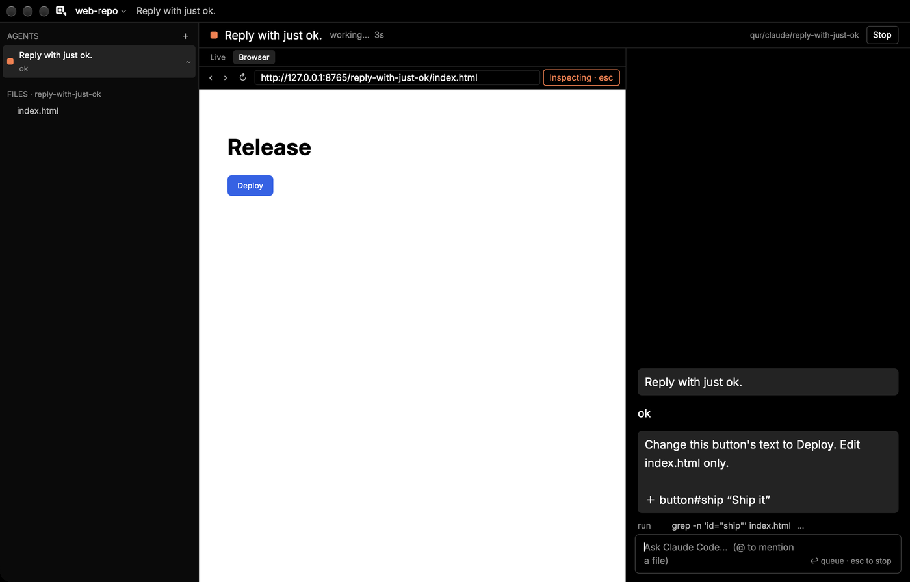

# Qur

**See what your agents see.**

Qur is a lightweight, native macOS code editor built around watching and steering AI coding agents. Agents are first-class: the sidebar lists your agents, each one works in its own git worktree, and the file tree glows as a live heatmap while they read and edit. When an agent is done, you review its changes and merge them.

Qur is written in Rust on [GPUI](https://github.com/zed-industries/zed) (Zed's UI framework). It has no Electron, runs locally, and uses your existing Claude Code login (never an API key).

> **Status: early development (pre-release).** Milestones M0–M3 and the Browser + Inspect milestone are done. M4 (Changes, Merge, Git panel) is in progress. macOS only for now. See [HANDOFF.md](HANDOFF.md) for the current state.


## What it does

- **Agents in worktrees.**
  - Each task gets its own git worktree outside your repo, on branch `qur/<agent>/<task>`. Your checkout stays untouched while agents work.
  - Run several agents at once, including several Claude tasks.
- **Structured agent sessions** over the [Agent Client Protocol](https://agentclientprotocol.com) (Claude Code via `claude-agent-acp`):
  - Chat with streaming tool calls, the agent's to-do plan, and a permission bar (Allow once / Allow for this task / Deny).
  - Stop at any time.
  - Messages you send mid-turn are queued; `@` mentions a file and `/` runs agent commands.
- **Live view.** Watch the file the agent is working in as it types. It's read-only while the agent edits, with **Take over** to step in. It follows the agent across files, but never jumps within 5 s of your own scroll or click.
- **Live file-tree heatmap.**
  - States: an outline on files waiting for your approval, a pulsing glow while editing, a fading glow while reading, and "new" or `+n −m` on changed files.
  - Heat deepens with how often the agent touched a file, and folders roll up their contents.
  - On your main checkout, dots show which files agents have changed in their worktrees.
- **Browser with Inspect.** Open your dev server next to the agent, hover and click elements (or select text), and ask the agent to adjust them. It gets the element's selector, HTML, key CSS, its source location when available, and a screenshot. It uses the system WebKit: no bundled browser engine, and the page is freed when idle.
- **Review and merge** (M4, in progress):
  - Review the task's diff and comment on lines to send feedback to the agent in one message.
  - A pre-check warns about conflicts; **Merge** never touches your staged changes or stash.
  - Resolve conflicts in-app, and use the Git panel to stage and commit.
- **Agent Terminals and terminals.** `Cmd+Shift+T` starts a terminal-mode Claude task in its own worktree; `Cmd+T` opens a shell.
- **A real editor.**
  - Code opens in a modal (`Esc` closes it) with tree-sitter highlighting for 13 languages.
  - Multi-cursor, find/replace with regex, soft wrap, and VS Code keybindings.
- **Looks.** 17 built-in themes plus Auto (follows macOS), a theme per project, and window transparency with blur. Every theme passes a contrast test.
- **Native and uncluttered.** Every command lives in the macOS menu bar and the command palette (`Cmd+Shift+P`).



## Lightness

Measured on a MacBook Air M5 with `scripts/budget.sh` (details in [docs/budget.md](docs/budget.md)):

| | Target | Qur |
|---|---|---|
| App binary | < 40 MB | ~25 MB, including 13 tree-sitter grammars (~11 MB) |
| Memory at idle, project + small file (physical footprint) | < 80 MB | ~71 MB |
| Memory with 3 Claude agents active (Qur's process) | < 150 MB | 81 MB |
| Start to first frame | < 250 ms | ~110–130 ms |
| Open a 10,000-line file, fully highlighted | < 100 ms | ~86 ms |
| Agent write → glow on screen (Qur unfocused) | < 100 ms | 81–84 ms |
| Keystroke handled and drawn (CPU side, p99) | ≤ 8.3 ms | ~3.5 ms |

## Requirements

- macOS (Apple Silicon tested; macOS 27).
- **Rust** (stable, via [rustup](https://rustup.rs)).
- **Xcode** with the Metal toolchain (GPUI compiles Metal shaders). If the build complains, run `xcodebuild -downloadComponent MetalToolchain` once.
- **git** 2.38 or newer (Merge uses `git merge-tree --write-tree`).
- For agents:
  - [Claude Code](https://claude.com/claude-code), logged in with your subscription (`claude` CLI).
  - The ACP adapter: `npm i -g @agentclientprotocol/claude-agent-acp@0.94.0`. Pin the version, and don't use `npx` at runtime.
  - Qur never sets `ANTHROPIC_API_KEY`; agents use their own CLI login.

## Build and run

```sh
git clone https://github.com/PEUR-Technologies/Qur.git && cd Qur
cargo build --release -p qur_app
target/release/qur ~/path/to/your/repo     # a folder (project) or a file; no argument reopens the last project
```

Then press `Cmd+Shift+N` to start an agent task. Describe it, press Enter, and watch.

Tests and budget:

```sh
cargo test --release --workspace   # includes the theme contrast test and ACP protocol tests against a fake agent
scripts/budget.sh 5                # weight budget; needs an unlocked screen (AC power recommended)
```

## Everyday keys

| Keys | |
|---|---|
| `Cmd+Shift+N` | New agent task (its own worktree) |
| `Cmd+Shift+T` / `Cmd+T` | New Agent Terminal / new shell |
| `Ctrl+1..9`, `Ctrl+Opt+↑/↓` | Switch sessions |
| `Cmd+I`, `Esc` / `Cmd+.` | Focus the prompt, stop the agent |
| `Cmd+P`, `Cmd+Shift+P` | Go to file, command palette |
| `Cmd+K Cmd+L`, `Cmd+1..5` | Cycle stage layouts; Live / To-do / Chat / Changes / Browser |
| `Cmd+Shift+C` | Browser: inspect element |
| `Ctrl+Shift+G` | Source control |
| `Cmd+K Cmd+T` | Theme (this project or all projects) |

The full list is in [docs/keymap.md](docs/keymap.md); every command is also in the menu bar ([docs/menus.md](docs/menus.md)).

## Configuration

Everything lives in `~/Library/Application Support/Qur/`. Nothing is ever written into your repo except by agents in their worktrees.

| File | What |
|---|---|
| `config.toml` | Your settings: theme, window opacity/blur, editor font, soft wrap, peek layout. Qur > Settings opens it; saved changes apply right away. |
| `agents.toml` | Which agents Qur can start (ACP or terminal mode). Written on first launch. |
| `projects/<id>.toml` | Per-project overrides: theme, opacity, and `[worktree] setup = "pnpm install"` run in each new worktree before the agent starts. |
| `projects/<id>.tasks.toml` | Tasks, so they survive restarts and resume their agent sessions. |
| `worktrees/<id>/<task>/` | The task worktrees. |

In your repo you can add a **`.worktreeinclude`** file, one path per line (e.g. `.env`, `node_modules`). Qur copies those into each new worktree with APFS copy-on-write: instant, and no extra disk space.

## How Qur compares

**Zed.** Qur is built on Zed's GPUI and shares its native feel, but it isn't a general-purpose editor with an agent panel. In Qur, the agents are the main view: the sidebar is a list of agents, and code appears in Live, the heatmap, the code modal and the review diff.

**Orca** ([stablyai/orca](https://github.com/stablyai/orca)) is the closest peer. We studied it closely ([docs/research/orca.md](docs/research/orca.md)) and adopted several of its ideas: worktree setup commands, `.worktreeinclude`, review comments sent back to the agent, and Design-Mode-style element inspect.

| | Qur | Orca |
|---|---|---|
| Tech | Rust + GPUI, native; ~25 MB | Electron + React; ~254 MB app |
| Agents in isolated worktrees | Always, outside the repo | Yes |
| Agent link | ACP (structured) by default, terminal fallback | Terminal by default; structured chat experimental |
| Live view of the agent's current file, with Take over | Yes | — |
| File-tree heatmap of agent activity | Yes | — |
| Permissions | Asked in a permission bar by default | Launches agents with permission-bypass flags by default |
| Shipping changes | Local Merge into your branch (index- and stash-safe) | Push and pull request |
| Browser + element inspect | System WebKit, freed when idle | Bundled Chromium |
| Telemetry / background daemon | None / none | Opt-out telemetry / keeps terminals alive after quit |

The comparison reflects our reading of Orca's repository and docs in October 2026; corrections welcome.

## Project layout

```
crates/
  qur_app       the app (binary `qur`): window, sidebar, stage, Live, Browser, Changes, Git panel, menus
  qur_acp       hand-rolled ACP v1 client (JSON-RPC over stdio, no async runtime)
  qur_agents    agent roster (agents.toml) and task store
  qur_worktree  task worktrees, .worktreeinclude, setup command
  qur_watch     FSEvents file watcher (debounced, .gitignore-aware)
  qur_heat      heatmap model (states, heat levels, diff stats)
  qur_git       diffs, merge (index- and stash-safe), conflicts, status/stage/commit
  qur_browser   system WKWebView embedding + element inspector
  qur_editor    UI-free editor model (rope, multi-cursor, undo, find, soft wrap)
  qur_syntax    tree-sitter highlighting for 13 languages
  qur_theme     17 themes + contrast tests
  qur_config    settings files
  qur_tree      lazy, gitignore-aware file tree
docs/           spec (QUR_HANDOFF.md), owner decisions, keymap, menus, budget, research
spikes/         M0 spikes and test fixtures
```

## Contributing

Qur is early and moving fast. Read [HANDOFF.md](HANDOFF.md) and [docs/decisions.md](docs/decisions.md) first.

House rules:
- Lightness is the product: measure with `scripts/budget.sh`, don't estimate.
- No UI that isn't in the spec or decisions.
- Agents only ever use their own CLI logins.

## License and credits

[GPL-3.0-or-later](LICENSE). © PEUR Technologies.

Themes are ported from their upstream projects under their licenses ([docs/THEME_CREDITS.md](docs/THEME_CREDITS.md)). Fonts, grammars and other components are listed in [docs/THIRD_PARTY.md](docs/THIRD_PARTY.md). The UI font is Inter (SIL OFL).

**Trademark:** "Qur" has not been through trademark clearance. Don't register or rely on the name commercially until it has.
